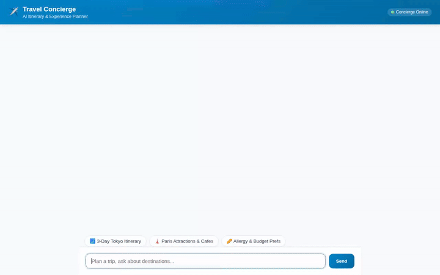

# ✈️ Travel Concierge Agent

An intelligent, full-stack AI travel concierge built with Google's **Agent Development Kit (ADK)** and deployed on **Vertex AI Agent Runtime**. The agent helps travelers discover destinations, manage preferences across sessions, generate visual travel postcards and video clips, search real-time places and weather, and calculate trip budgets.



---

## 🌟 Implemented Features & Architecture

The codebase (`app/` and `frontend/`) implements the following Google Cloud services, ADK features, and API integrations:

- **🧠 Durable Cross-Session Memory Bank**: Integrated with **Vertex AI Memory Bank** (`VertexAiMemoryBankService`) and an `after_agent_callback` to store and recall traveler preferences (e.g. dietary restrictions, allergies, budget tiers, and past itineraries) across sessions.
- **🖼️ AI Postcard Image Generation**: Powered by `gemini-3.1-flash-lite-image` in the `global` region to generate scenic travel postcards. Images are saved as ADK artifacts (`tool_context.save_artifact`) and uploaded to Google Cloud Storage.
- **🎥 AI Video Generation**: Powered by Google's **Omni model (`gemini-omni-flash-preview`)** in the `global` region to generate short travel video previews.
- **☁️ Cloud Storage Asset Hosting**: Raw image and video bytes are uploaded directly from memory to a public Google Cloud Storage bucket (`travel-concierge-assets-qwiklabs-gcp-02-a60a9ebc8d0d`), returning public HTTPS URLs.
- **💻 Agent Engine Sandbox Code Execution**: Uses `AgentEngineSandboxCodeExecutor` to safely execute Python code in a sandboxed execution environment for budget calculations and currency conversions.
- **📍 Google Maps Geocoding & Places API**: Custom function tools (`geocode_address`, `find_nearby_places`) to convert locations into coordinates and retrieve nearby venues via Google Places API (New).
- **🗄️ Firestore Database Integration**: Connected to Google Cloud Firestore (`google.cloud.firestore`) for persistent destination options and itinerary management.
- **🎨 A2UI Rich Card Rendering**: Uses ADK's `A2uiSchemaManager` (v0.8 Basic Catalog) and `after_model_callback` (`a2ui_callback`) to emit UI cards for destinations and schedules.
- **⚡ FastAPI Proxy & Chat Frontend**: A custom Python FastAPI backend (`frontend/main.py`) translating browser Agent-to-Agent (A2A) protocol calls to the Vertex AI Reasoning Engine endpoint, paired with a cyan-accented HTML/CSS chat user interface (`frontend/static/index.html`).

---

## 🚀 Setup and Local Execution

### Prerequisites

- Python 3.11+
- Google Cloud SDK (`gcloud`) authenticated to your GCP Project
- Node.js (for Playwright demo recorder)

### 1. Environment Setup

Copy or set your environment variables in a `.env` file in the project root:

```bash
GOOGLE_CLOUD_PROJECT="your-gcp-project-id"
GOOGLE_CLOUD_LOCATION="us-east1"
GOOGLE_MAPS_API_KEY=<YOUR_MAPS_API_KEY>
```

### 2. Install Dependencies

```bash
# Install agent dependencies
pip install -r requirements.txt

# Install frontend proxy dependencies
cd frontend
pip install -r requirements.txt
cd ..
```

### 3. Run Agent Local Playground

To run the agent interactively in the ADK Web Playground:

```bash
adk web --port 8000
```

### 4. Run Custom FastAPI Frontend

To start the custom FastAPI proxy server and chat interface locally:

```bash
export AGENT_ENGINE_RESOURCE_NAME="projects/<your-project-id>/locations/us-east1/reasoningEngines/<engine-id>"
export AGENT_DIRECTORY="app"
export PORT="8080"

cd frontend
python main.py
```

Open your browser to `localhost:8080` to interact with the Travel Concierge frontend.

---

## 🚢 Deployment

### Deploy Agent to Vertex AI Agent Runtime

```bash
agents-cli deploy agent_runtime \
  --project your-gcp-project-id \
  --region us-east1 \
  --update-env-vars GOOGLE_MAPS_API_KEY=<YOUR_MAPS_API_KEY>
```

### Deploy Frontend to Cloud Run

```bash
cd frontend
gcloud run deploy travel-concierge-frontend \
  --source . \
  --region us-east1 \
  --allow-unauthenticated \
  --set-env-vars AGENT_ENGINE_RESOURCE_NAME="$AGENT_ENGINE_RESOURCE_NAME",AGENT_DIRECTORY="app" \
  --project your-gcp-project-id
```

---

## 📁 Repository Structure

```
.
├── app/
│   ├── agent.py          # Root ADK agent configuration, tools, and Memory Bank integration
│   ├── a2ui_utils.py     # A2UI model callback for UI card rendering
│   └── __init__.py
├── frontend/
│   ├── main.py           # FastAPI proxy forwarding A2A requests to Vertex AI
│   └── static/
│       └── index.html    # Rebranded chat UI & A2UI mini-renderer
├── agents-cli-manifest.yaml # Agent manifest configuration
├── demo.gif              # Optimized looping demo recording
├── deployment_metadata.json # Agent deployment metadata
└── requirements.txt      # Python dependencies
```
